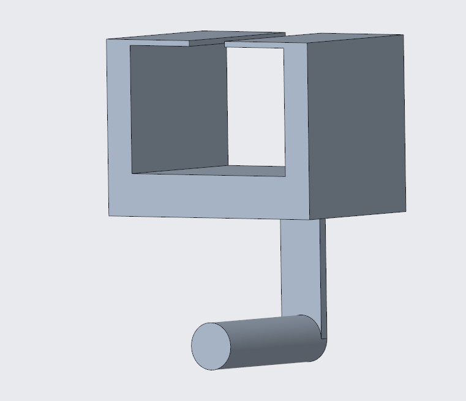
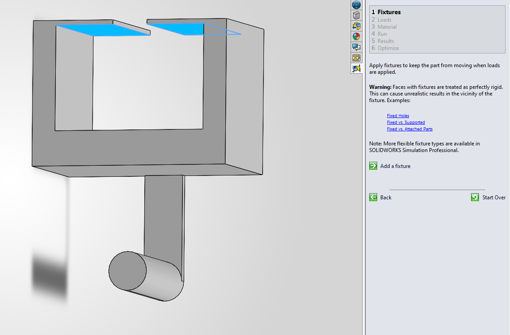
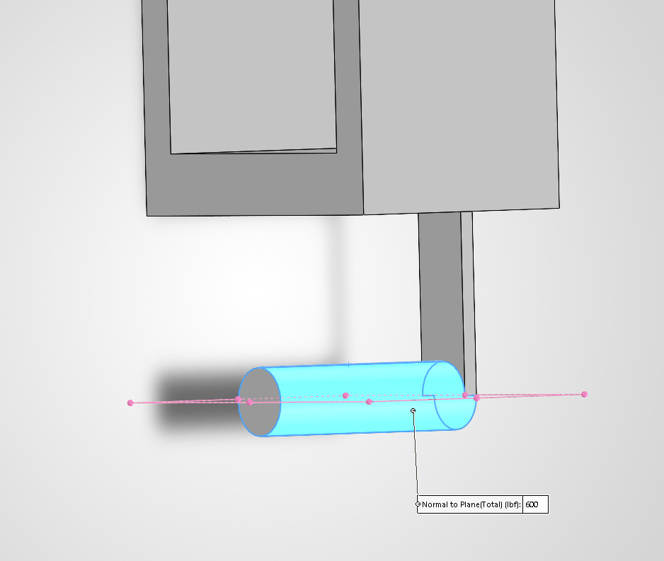
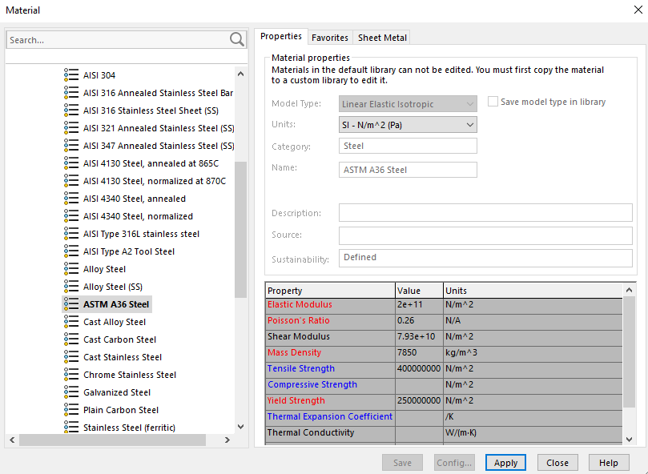
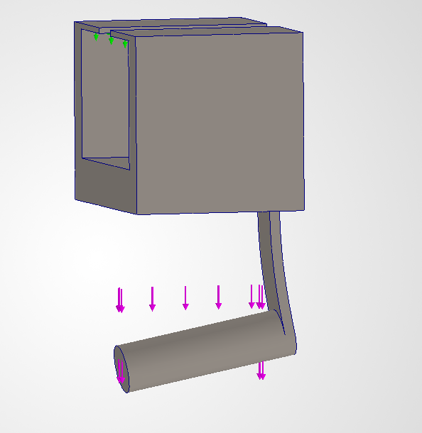
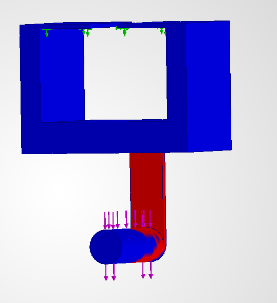
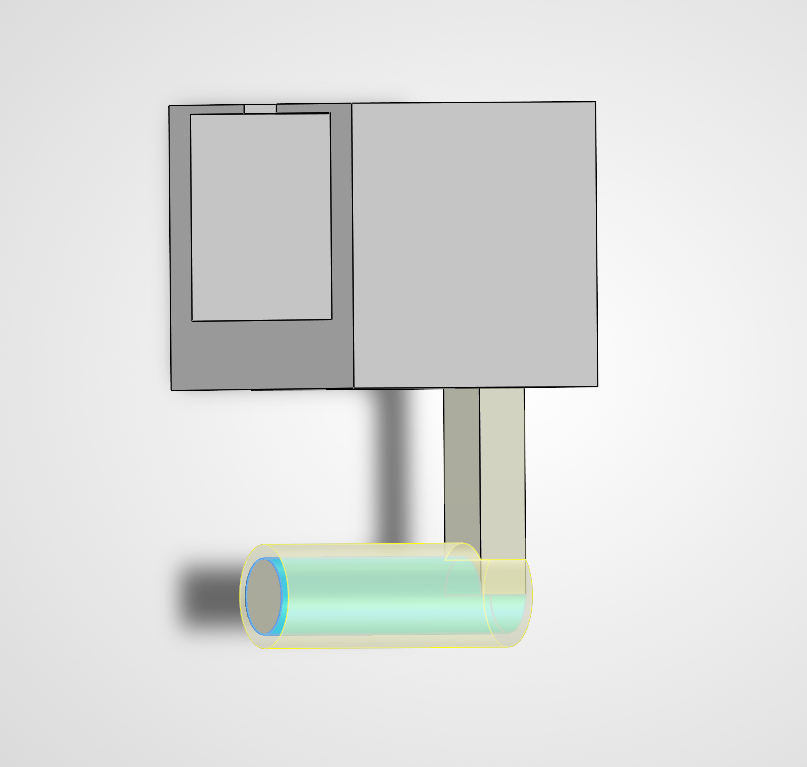
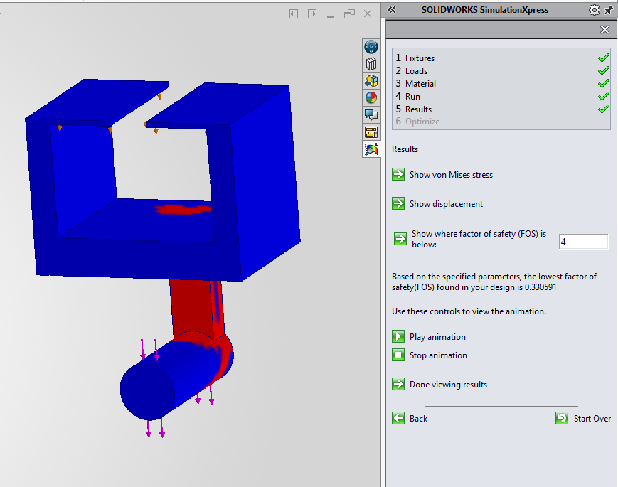
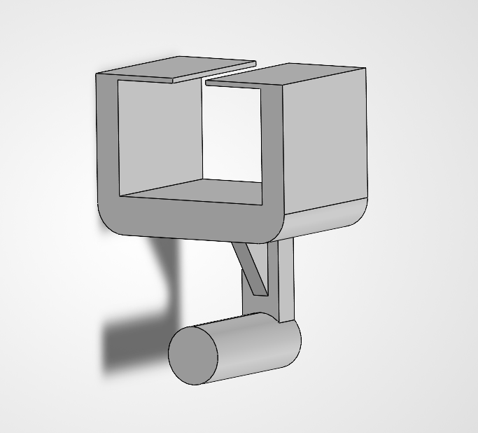
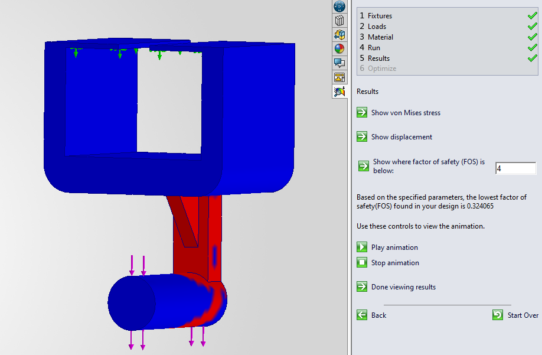

### A7 – Finite Element Analysis on Bracket

### Objective
The objective of this assignment is to use Finite Element Analysis (FEA) to improve the bracket design from a previous assignment. There will be multiple iterations of the design and for each one I will be running simulations to analyze stress, deflection, and safety factor. Then I will be making changes to increase strength and stiffness while reducing weight. Different mesh sizes will also be tested to ensure accurate results.

## Iteration 1 – Original Design

### Setup
Material: ASTM A36 Steel
Applied Load: 600 lbf

I designed the part in Creo originally, but imported it into SolidWorks to run the stress analysis. 

Here I selected the surfaces where the bracket is held in place.

Here I applied the force to the cylindrical part of the bracket.

Here I assigned the material used for the bracket.

Here I analyzed how the bracket deforms under the applied load.

Here I checked the stress with a factor of safety of four. The entire top portion is blue, meaning it can withstand the current stress.

### Iteration 1 Results

The lowest factor of safety found in this simulation was 0.07432. The bottom portion of the bracket is relatively thin, there was an obvious mistake in my earlier calculations so that part will be made thicker.

## Iteration 2 – Modified Design

### Design Changes

For this design, the thickness of the bottom cylinder and its connecting support were increased.

This is a simulation of the part.

### Iteration 2 Results
The factor of safety increased to 0.330591, but is still way below the necessary safety of 4.

## Iteration 3

### Design Changes

I added a triangular gusset in an attempt to reduce the strain on the bottom of the bracket. I also removed some of the material with a bevel.

This is the final simulation ran on the part.

### Results
The factor of safety had actually decreased  to 0.0324065 after adding the gusset. This left me confused, but it may have needed to extend lower.

### Final Design Comparison
My second design could theoretically withstand more force, but my final design was lighter than it. The first design was the lightest but had a much lower safety factor.

## Comparison
| Measurement | Design I | Design II | Design III |
|---|---|---|---|
| Max Stress and Location | Bottom | Bottom | Bottom |
| Mass (pounds) | 1.62 | 1.78 | 1.75 |
| Safety Factor | 0.07432 | 0.330591 | 0.324065 |
| Number of Elements | 5 | 5 | 7 |

### Lessons Learned
This was my first time using solid works, I enjoyed learning it. I had trouble adding the gusset, but I was able to find a tutorial online.

### Time Spent
I spent around 3 hours on this project.

### Final CAD File
<a href="https://github.com/DillonK-spec/megr2157-portfolio/blob/main/docs/assignments/A07/bracketiteration3.SLDPRT" download>Download File</a>
