# A8 – Gearbox Design

The objective of this assignment is to design a gearbox that can be assembled and disassembled. This includes analyzing the shafts, selecting journal bearings, and creating a two-part gearbox housing in SolidWorks.

## Shaft  Design

### Input Shaft

Knowns:

Diameter: 0.125 in

Length: 1 in

Gear ratio: 24:9

 

Unknowns:

Input torque

Maximum shear stress

Shaft strength

 
Free Body Diagram:

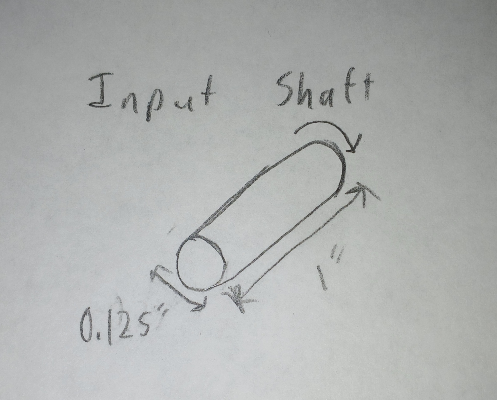

 

### Output Shaft

Knowns:

Diameter: 0.25 in

Length: 1 in

Output torque: 1.25 in-lbf

Output speed: 1100 rpm

Unknowns:

Maximum shear stress

Shaft strength

Free Body Diagram:
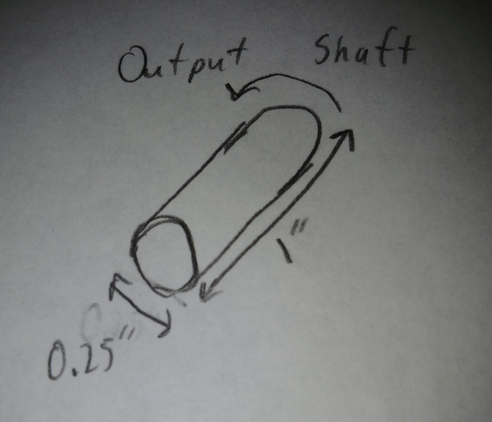

Calculations:
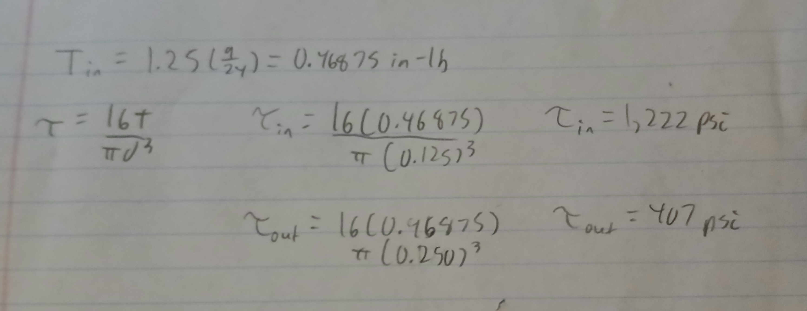

Input torque needs to be 0.46875 in-lbf.
Input shaft stress is 1,222 psi and output shaft stress is 407 psi.
Both shafts were then analyzed using 1018 steel with a yield strength of 54,000 psi.
The input shaft has a safety factor of 22.09 and the output shaft had a safety factor of 66.27. Both of these exceed the Machinery's Handbook maximum recommendation of 3.

## Journal Bearing Designs

Bearing Size and Material:
The inner diameter of the journal bearings will be based on the diameter of the shafts and the material is going to be selected based on load, speed, and PV rating. 

Knowns:

Input shaft diameter: 0.125 in

Output shaft diameter: 0.250 in

Input shaft speed: 2933.33 rpm

Output shaft speed: 1100 rpm

Output torque: 1.25 in-lbf

Input torque: 0.46875 in-lbf

Unknowns:

Bearing load

Bearing length

Bearing pressure

Surface velocity

PV rating

Bearing material

Bearing thickness

Calculations:

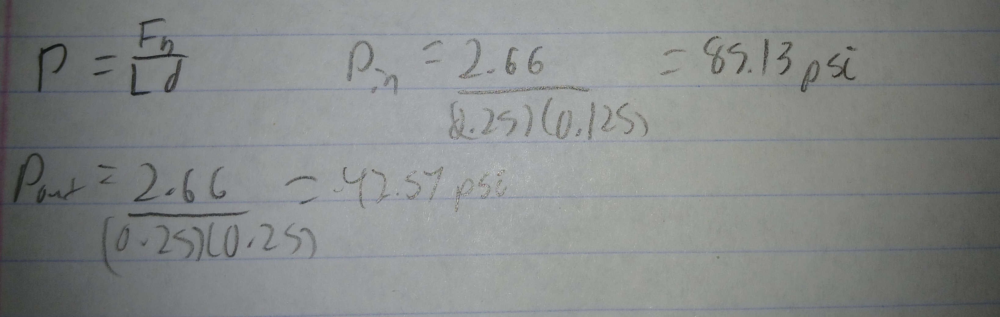
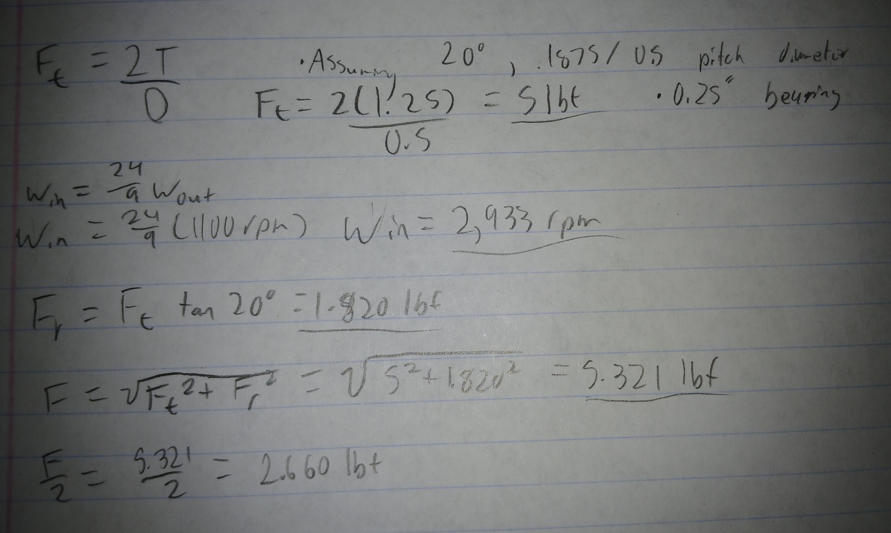
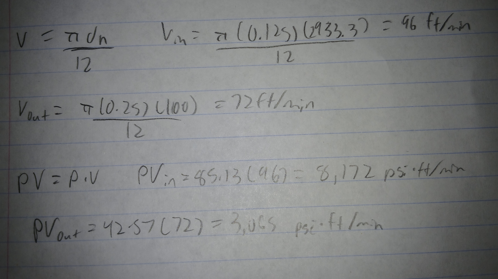

Selected Bearings
The bearing thickness was selected based on the shaft diameter and the required outside diameter of the bearing. Inner diameter was already known, the bearing will have a wall thickness of 0.03125.

## SolidWorks CAD Modeling

I started the modeling by creating a sketch for the shaft.

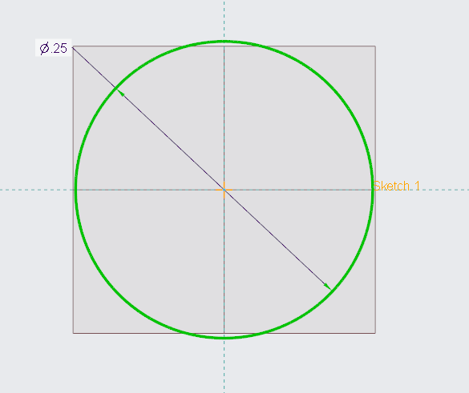
 

I extruded the sketch to be an inch.

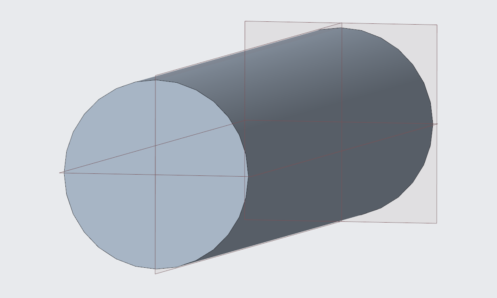
 

I placed the shafts in an assembly and added the gears.

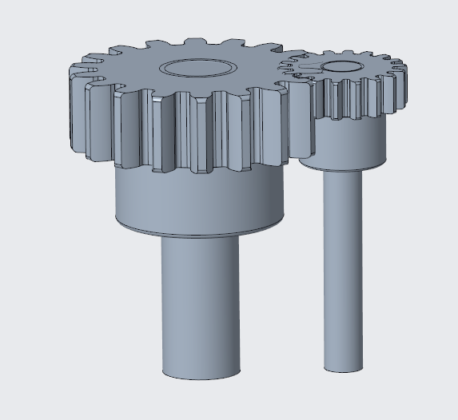
 

I added the journal bearings to the shafts.

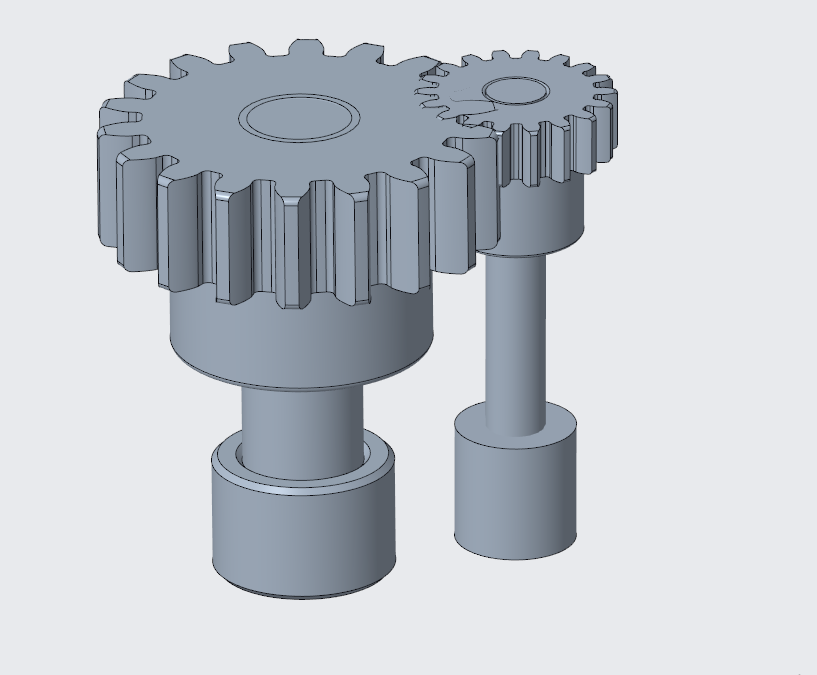
 

I created a housing for the lower portion.

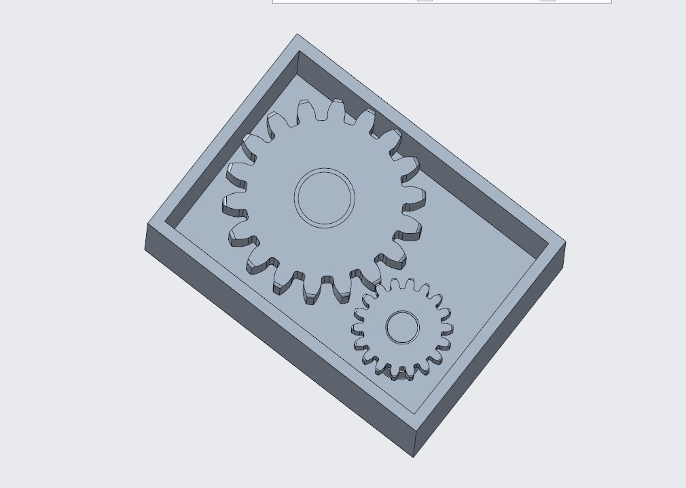
 

I created a housing for the top portion.

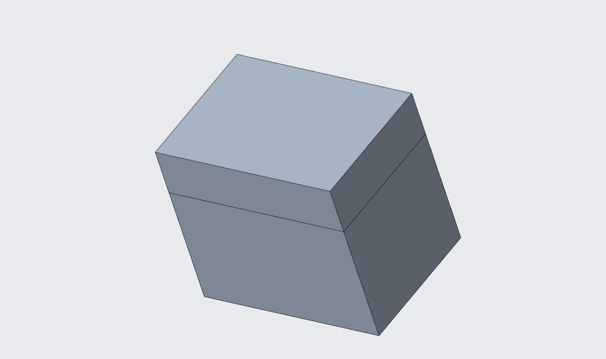
 

## CAD Files

Download Final Assembly:
<a href="https://github.com/DillonK-spec/megr2157-portfolio/blob/main/docs/assignments/A08/a8creo.asm.zip" download>Download File</a>

## Reflection

In this assignment, I designed a gearbox in Creo and did the calculations for the shafts and bearings. Both shafts were strong enough for the loads, and I used the bearing calculations to help determine what sizes would work. The modeling took some trial and error, especially when trying to get everything to fit together properly. I could not find a correct gear pair with the same ratio, but my model still has all the aspects of a gear box.

This project took 7 hours.
