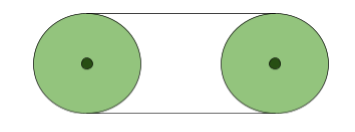
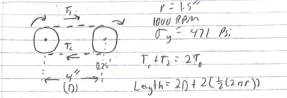
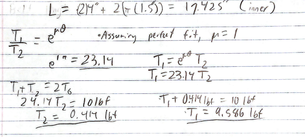
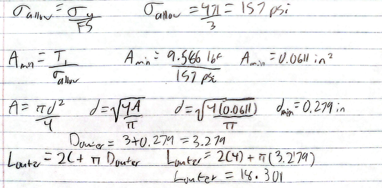
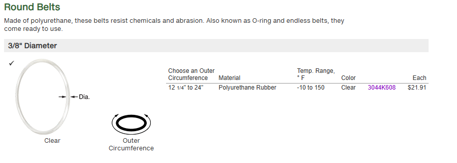
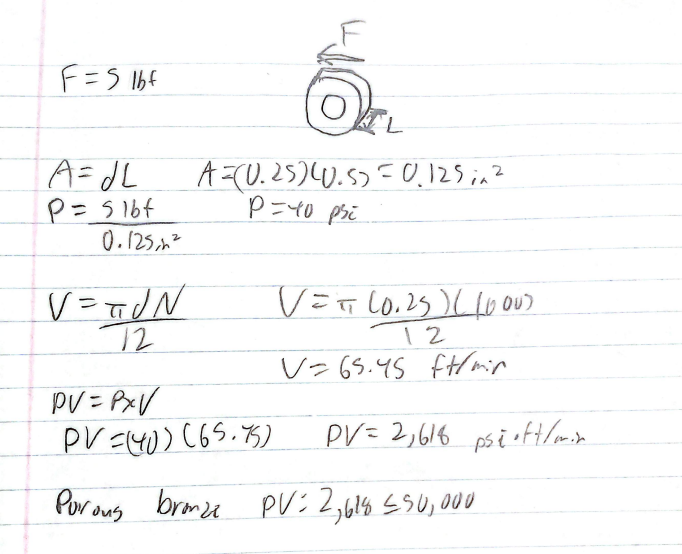
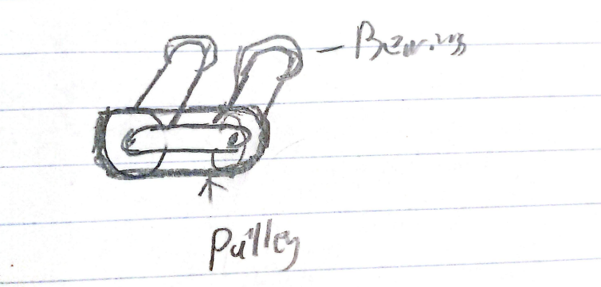

# A9 – Pulleys

The objective of this assignment is to design a pulley system that transfers power between two shafts. This includes selecting a belt, calculating the minimum shaft diameter, choosing journal bearings, and designing a frame to support the system.

## Specifications

The pulley system will consist of two 3-inch diameter aluminum pulleys separated by a center distance of 4 inches, operating at 1000 RPM with a static belt tension of 5 lbf. The belt will be made of polyurethane rubber with a yield strength of 471 psi, and the shafts will be made of 1060 hardened steel. The system must maintain a minimum factor of safety of 3.

## Force Analysis

### Tension Calculations

I first sketched the pulley system with a 4-inch center distance and identified the tight and loose sides of the belt.

Unknowns: T1, T2, F, M, L

I used the belt friction equation with a coefficient of friction of 1 to calculate the tight-side and loose-side tensions. Minimum length can be found easily, it needs to be 17.425 inches inside. The belt will be longer since it's not infinitely thin.

Using the belt's yield strength and a factor of safety of 3, I calculated the minimum cross-sectional area, diameter, and outer circumference.

### Belt Selection

The belt I found that was the closest to theoretical values was 18.5 inches long and had a 3/8 diameter. 

### Journal Bearing Selection
I calculated the bearing pressure, surface velocity, and PV rating. Based on these values and the Machinery's Handbook, I selected porous bronze for the bearings.

### Frame Design
Finally, I sketched a frame concept to support the pulley system and hold the shafts and bearings in position.

## Takeaways

This project helped me visualize the force transfer through belts much better, it reinforced the tension difference between sections. Overall, this assignment helped me better understand how the different components of a pulley system work together and how engineering calculations can be used to select them. This project took around 4 hours to complete.
