# A10 – Lead Screw Design

## Objective
The objective of this assignment is to design and build a mechanically driven tensile tester. The tester must be capable of applying up to a 2 kN axial load. It must also have a controllable crosshead speed  
from 1mm to 50mm per minute and be designed with a safety factor of 4. The leadscrew must be at least 18 inches and it's preferred to be short enough to fit on a workbench.

Below is the concept image given.

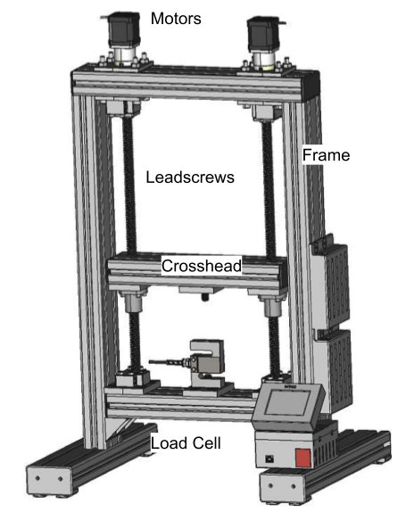

## Lead Screw Selection

### Thickness

These are the knowns and unknowns for the lead screw:

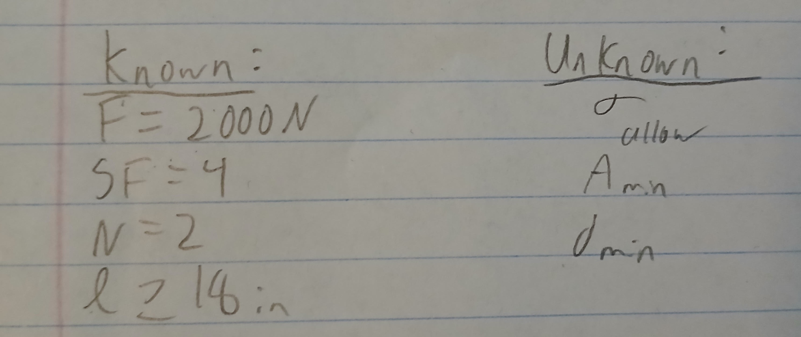

Here is the FBD and numerical solving for the screw. The required force is split along two screws, but they need a safety factor of four.

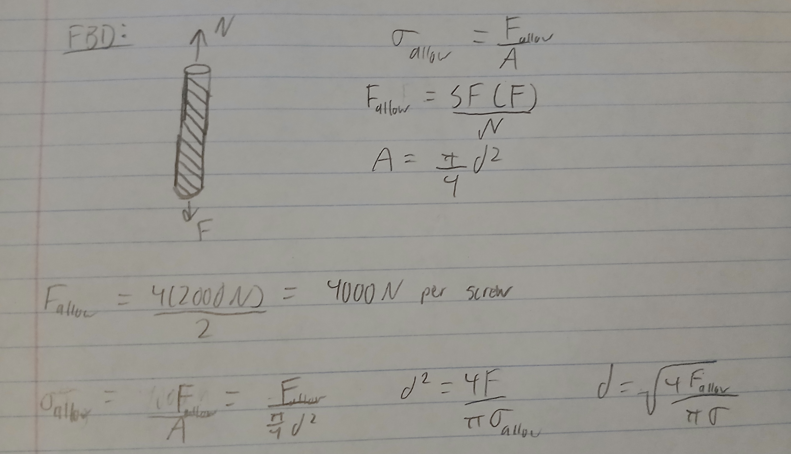

The provided resources show leadscrews made with steel or stainless steel. The minimum yield strength for steels is around 205 MPa, so I will use that to calculate minimum diameter.

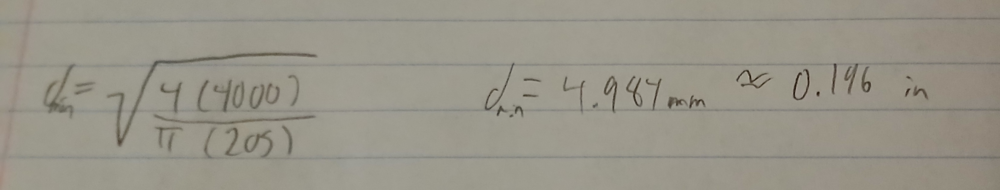

### Rotational Speed

Here are the knowns and unknowns for to determine the rotational speed based on a range of vertical speeds.

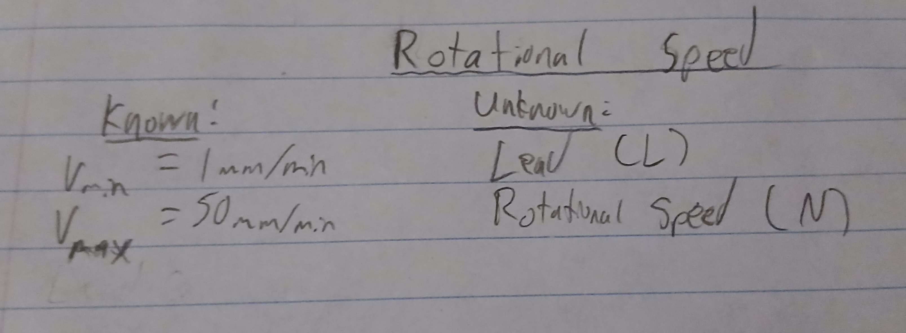

This is a free body diagram demonstrating how the nut translates around the screw. I made a mistake here for lead, it's 1/TPI, not TPI.

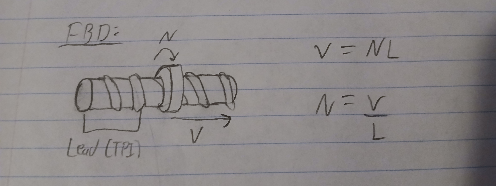

These are the calculations, I just chose 0.1 as as the lead since 10 threads per inch seemed common. The lead screw will operate from 0.394 to 19.68 RPM.

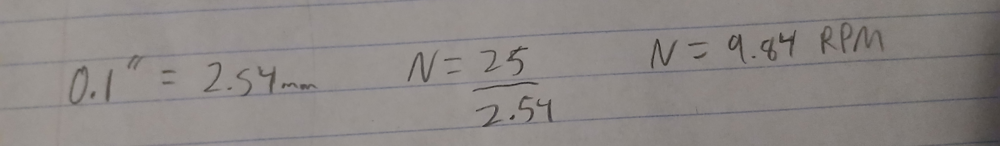

### Torque 

The coefficient of friction between steel and bronze was assumed to be 0.16, using this [Coefficient of Friction Reference Chart](https://www.schneider-company.com/coefficient-of-friction-reference-chart/) as a reference.

Here are the knowns and unknowns to find the Torque:

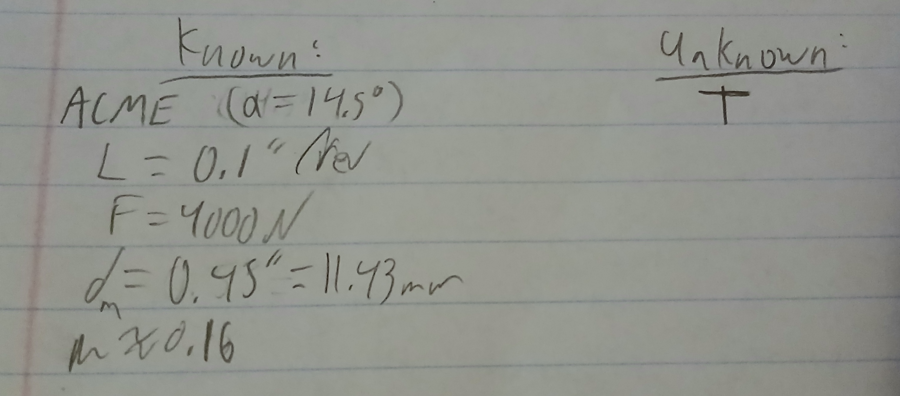

This is a rough free body diagram for the torque and the required formula.

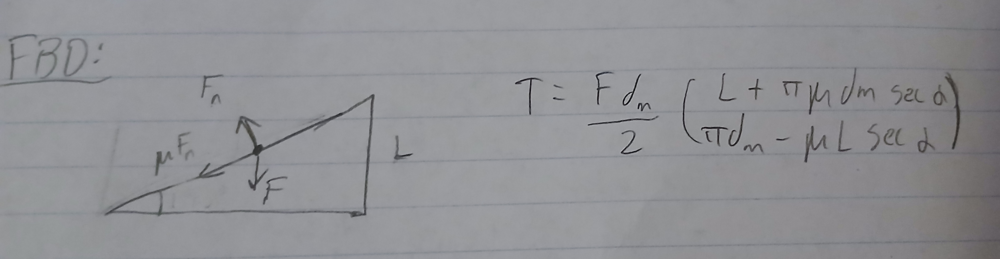

I plugged in the values and found the torque to be 5.459 Newtons times meters. 

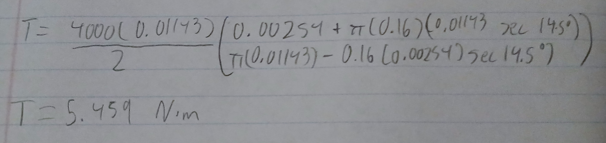

### Lead Screw Selection

The lead screw I selected has a part number 98935A911 on mcmaster.com. It's 24 inches long and has a 64,000 psi tensile strength, which equates to 441 MPa. I used 205 MPa in my earlier calculations, but it was for yield strength, which is always lower. ASTM A108 has a minimum yield strength of 195MPa which is slightly lower than my calculations. Considering the safety factor of 4 and the larger than necessary diameter, this lead screw shouldn't deform. 

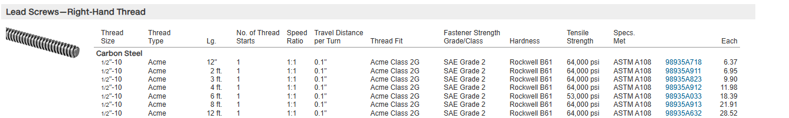

## Nut Selection

These are the known forces for the nut.

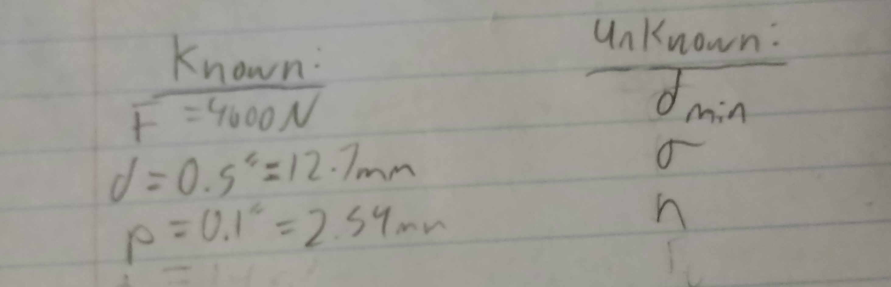

This is the FBD for the nut and the required equations.

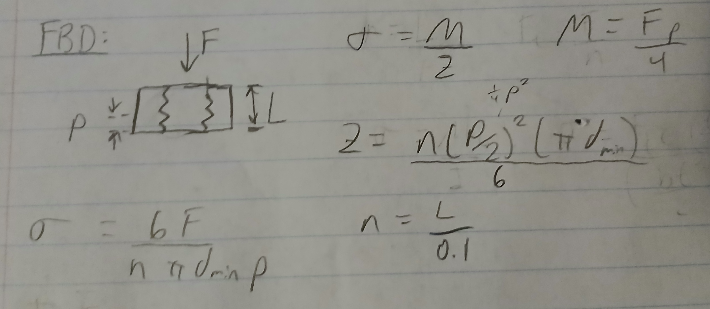

This is my calculation for the bending stress. I used 10 threads in the calculation because that was the first flange nut I saw with the same thread type.

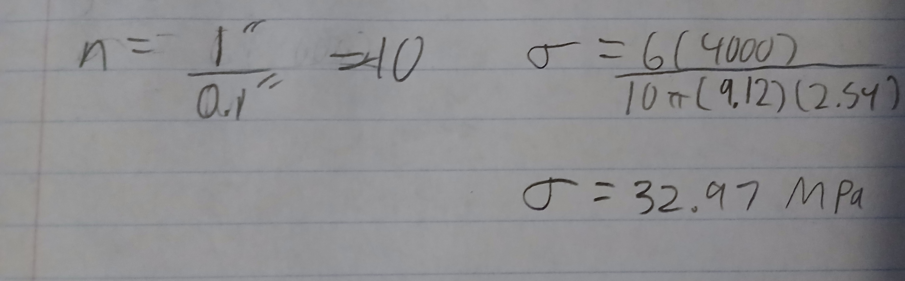

This is the nut I ended up choosing, it has part number 95120A111 on McMaster-Carr. Other nuts made of the same material have a tensile strength of 35,000 psi, or 241 Mpa which put it well above the calculated stress. 

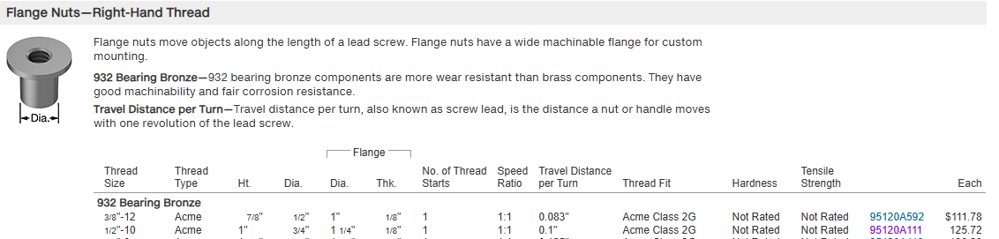

## Crosshead Design

For the crosshead design, I used a length in the range found in "Design, Manufacture, and Testing of an Open Source Tensile Testing Machine for Hands on Learning". I decided to use reasonable lengths and test if they would meet the requirements. It will be made from aluminum. 

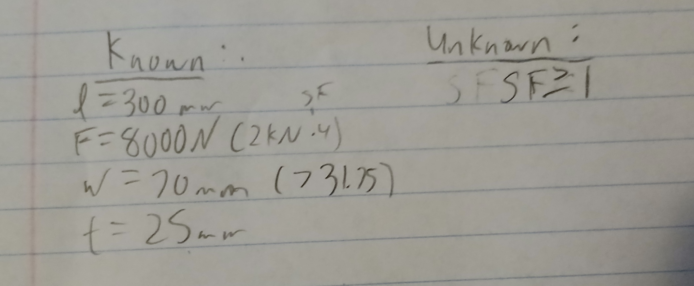

Here is a diagram of the crosshead and the formulas I'll use.

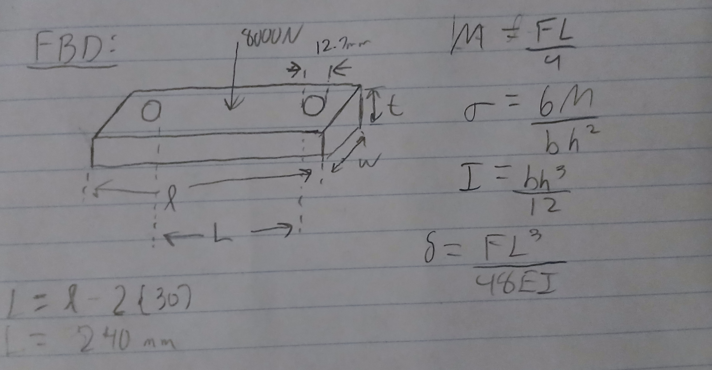

These are the calculations for the dimensions I chose. The initial thickness caused too much deflection, so I increased it to 40mm.  

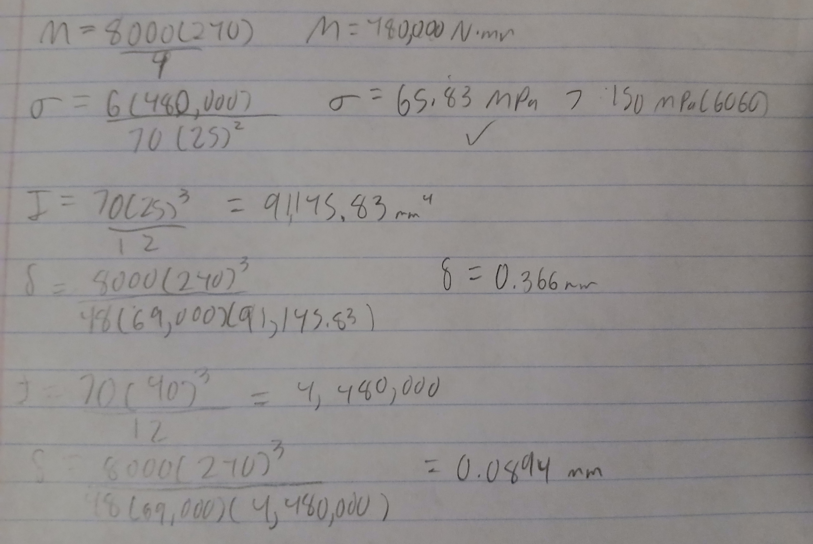

Here is a drawing of the crosshead. It's missing tolerances for the fit, but it will be added later.

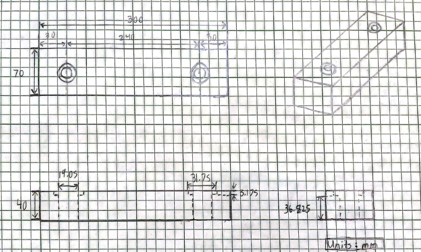

## Cost Analysis

| Item Number | Quantity | Name | Cost/Item | Total Cost | Purchase Link |
|:---:|:---:|---|---:|---:|---|
| 1 | 2 | 1/2"-10 Acme Lead Screw | $6.95 | $13.90 | [Purchase](https://www.mcmaster.com/98935A911/) |
| 2 | 2 | 932 Bronze Flanged Nut | $125.72 | $251.44 | [Purchase](https://www.mcmaster.com/95120A111/) |
| 3 | 4 | Aluminum Frame Material | $12.25 | $48.98 | [Purchase](https://www.lowes.com/pd/Mecale-23-6-in-4040-Aluminum-Extrusion-T-Slot-Linear-Rail-4-Pack-6063-T5-Anodized-Profile-Black/5021607235) |
| 4 | 1 | 6060 Aluminum Crosshead | ~$10.00 | ~$10.00 | N/A |
| | | | **Total Cost** | **$324.32** | |

## Parametric Modeling

I started the CAD modeling by creating the crosshead.

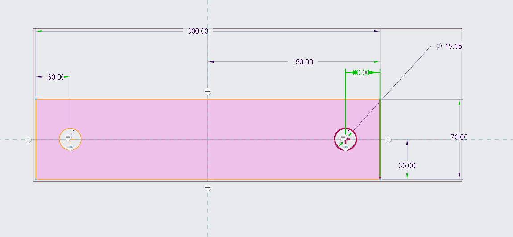

I extruded it and added space for the flange.

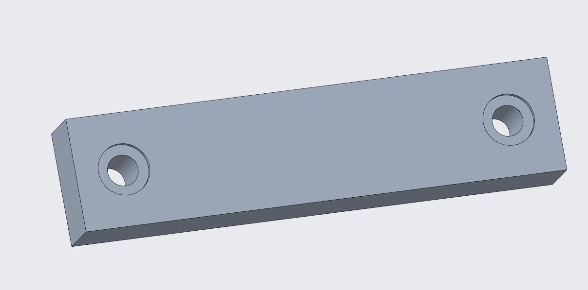

I imported the crosshead, flanges, and leadscrews into and assembly.

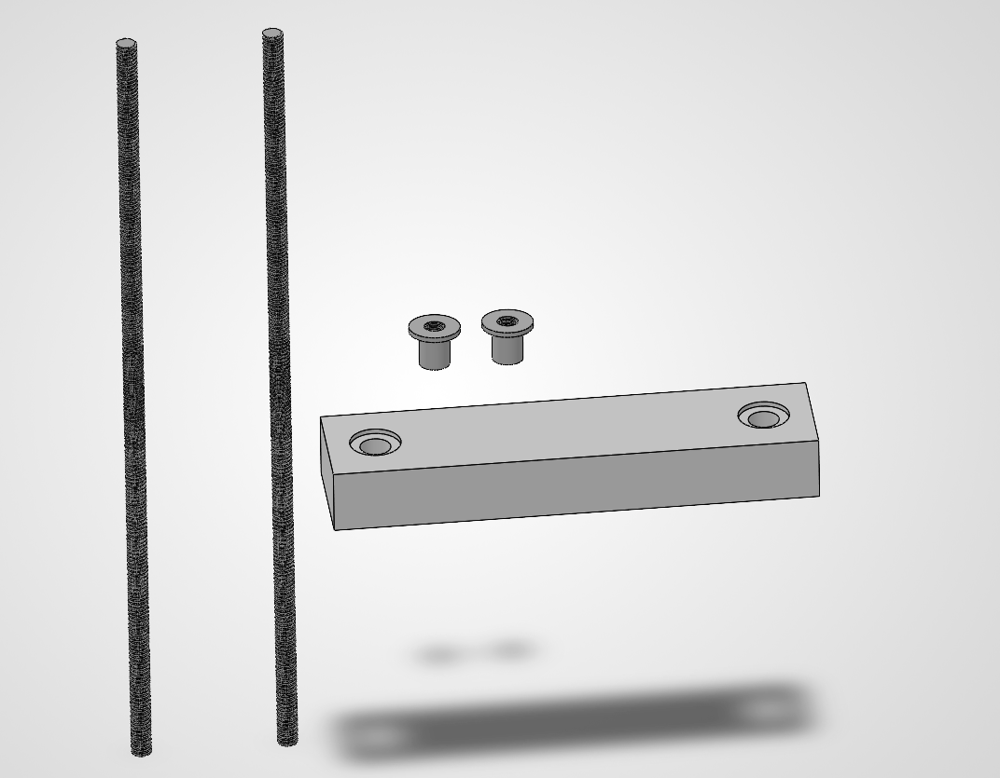

I mated all of the parts.

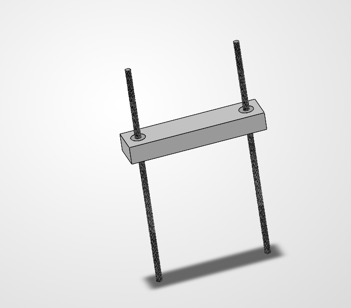

I cut aluminum supports to size and put them in the assembly.

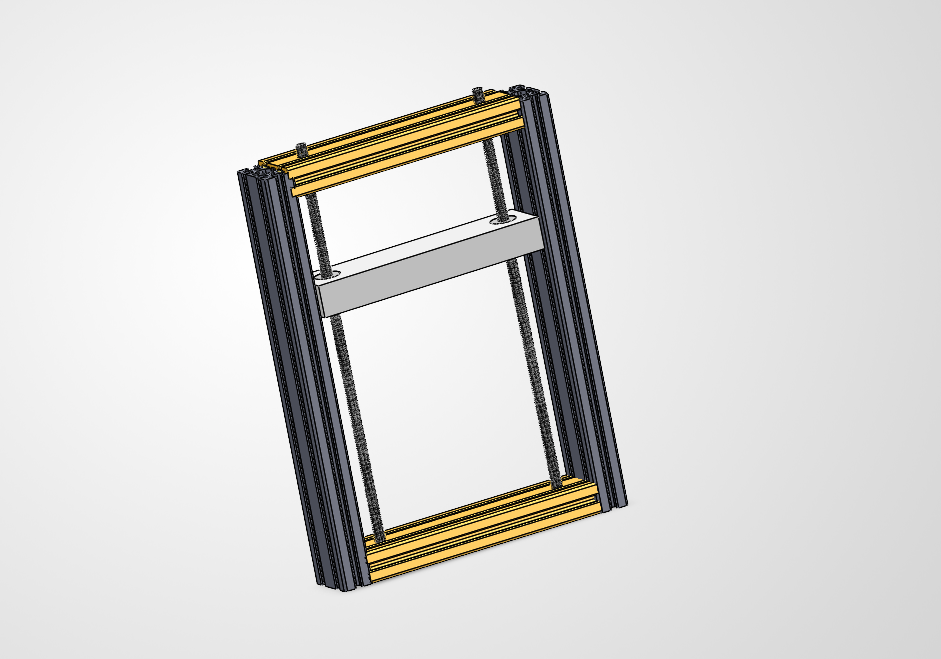

### CAD File

[Download CAD File](https://github.com/DillonK-spec/megr2157-portfolio/raw/refs/heads/main/docs/assignments/A10/tensiletester.zip)

## Takeaways

This project was my first experience making an assembly in SolidWorks. I had trouble converting the downloaded files to millimeters and had to scale them manually. I got to read and browse the web a lot for this project, which added to the time I spent. Overall, I spent around 13 hours making this tensile tester. 

