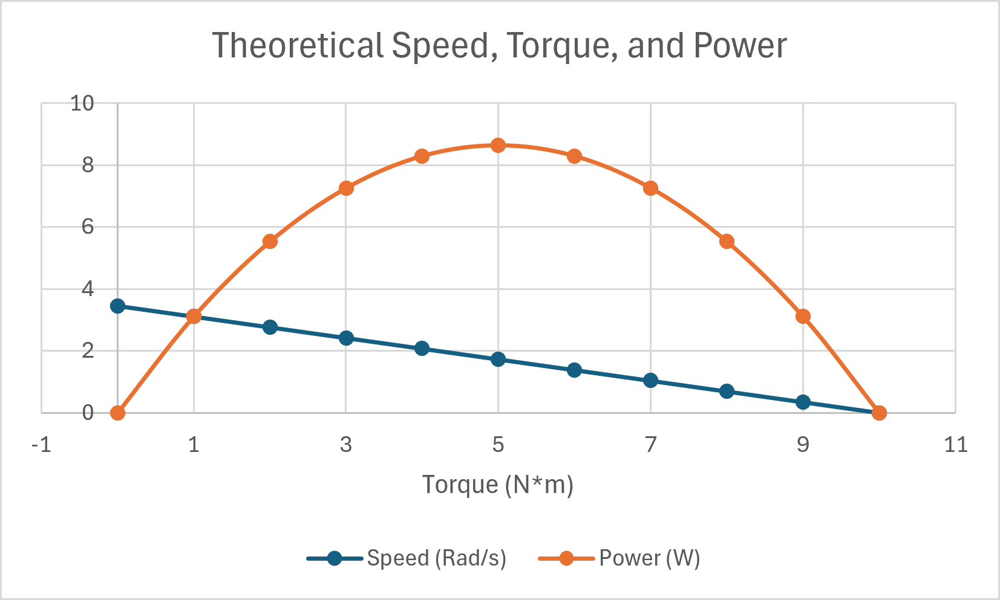
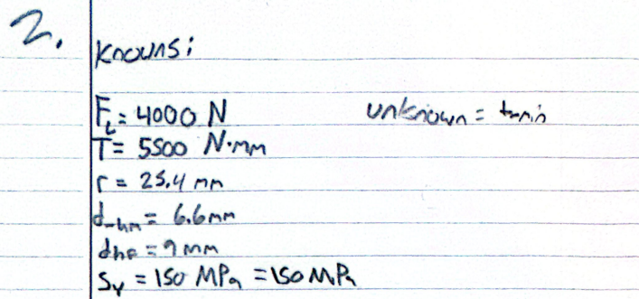
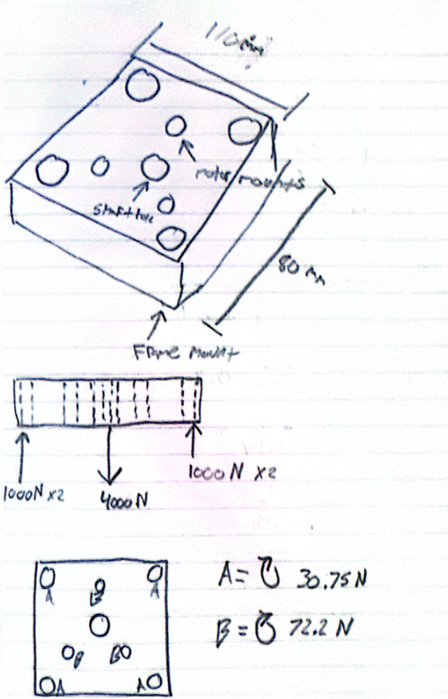
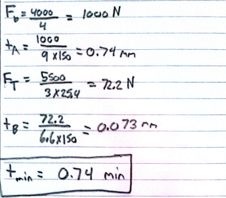
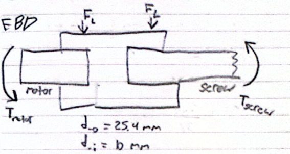
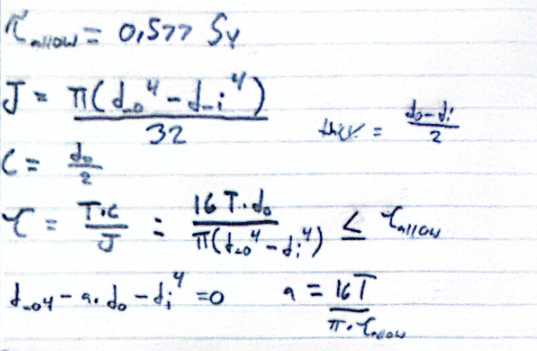
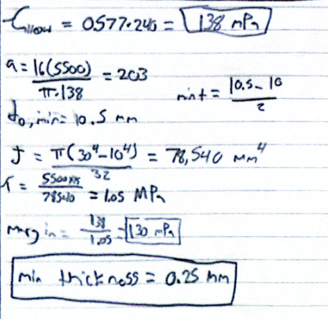
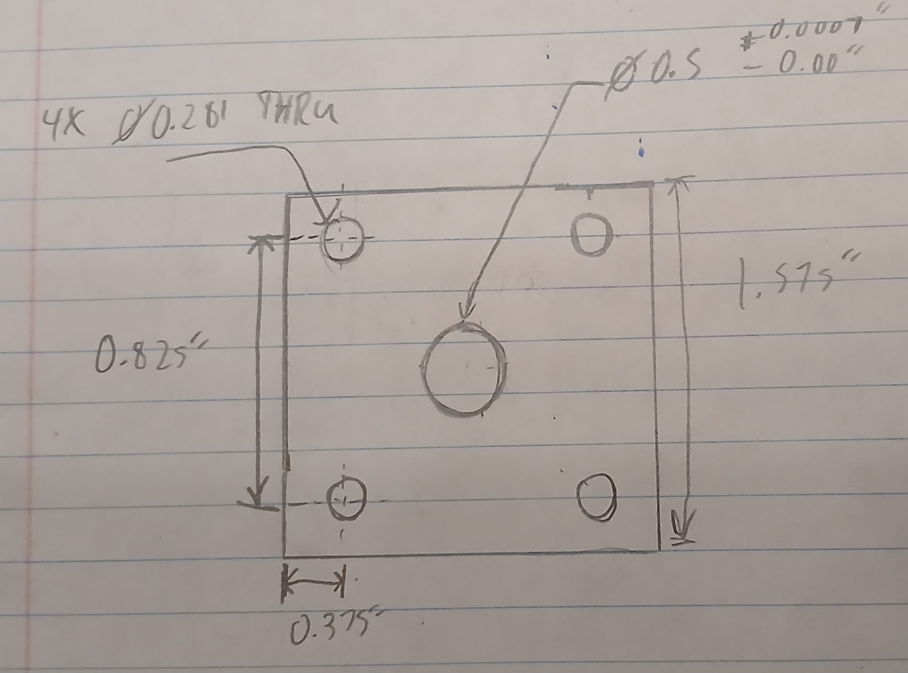

# A11 – Motor Selection

## Objective
In this project, we will continue designing a tensile tester that can withstand a 2kN load. We will be selecting motors to drive the leadscrews, designing motor mounts and then creating a frame. Our group includes Dillon Knight, Marvin Sibelius, and Sean Chadwick.

## Specifications

Maximum tensile load: 2,000 N

Number of leadscrews: 2

Leadscrew length: 24 inches

Leadscrew diameter: 1/2 inch

Leadscrew lead: 0.1 in/rev

Required travel speed: 1–50 mm/min

Factor of safety: 4

Leadscrew material: ASTM A108

## Motor Selection (Dillon)

Each leadscrew requires 5.459 N·m of torque. Since each leadscrew will be driven by its own motor, both motors must be capable of producing at least this amount of torque. Each motor must also operate over an output speed range of approximately 0.394–19.685 RPM.

A DC gearmotor is being considered because the leadscrews require relatively high torque at low speeds. A motor with an output speed near 20 RPM and a continuous torque rating of at least 5.459 N·m would be suitable.
I found a motor rated for 6 N*m and 28RPM [Here](https://cautop.com/mall/show-1993526.html)

I used excel to generate theoretical speed and power values based off of torque. 10 N*m is the peak torque listed and my excel formula for speed was “(33*(1-A2/10))*2*PI()/60”  which linearly decreased the speed from 33 to 0 and converted RPM to Rad/s.

This is the generated graph showing the relationship between torque, speed, and power.

## Motor Mount Design (Sean)

## Coupler Design (Sean)

## Mounting Bearing (Dillon)

An RC3 running fit was used for the floating bearing mount at the bottom of the leadscrew. For the 0.5 inch diameter leadscrew, the hole has a tolerance of +0.0007”/-0.00” and the shaft has a tolerance of -0.0006”/-0.001”. The mounts are placed directly under the leadscrew. 

This bearing plate will be 0.5” thick and use 0.1/4”-20 bolts at each corner.

## Bill of Materials (Dillon)

| Item Number | Quantity | Name | Cost/Item | Total Cost | Purchase Link |
|:---:|:---:|---|---:|---:|---|
| 1 | 2 | 1/2"-10 Acme Lead Screw | $6.95 | $13.90 | [Purchase](https://www.mcmaster.com/98935A911/) |
| 2 | 2 | 932 Bronze Flanged Nut | $125.72 | $251.44 | [Purchase](https://www.mcmaster.com/95120A111/) |
| 3 | 4 | Aluminum Frame Material | $12.25 | $48.98 | [Purchase](https://www.lowes.com/pd/Mecale-23-6-in-4040-Aluminum-Extrusion-T-Slot-Linear-Rail-4-Pack-6063-T5-Anodized-Profile-Black/5021607235) |
| 4 | 1 | 6060 Aluminum Crosshead | ~10.00|~10.00 | N/A |
| 5 | 2 | DC Worm Gear Motor | $18.05 | $36.10 | [Purchase](hhttps://cautop.com/mall/show-1993526.html) |
| | | | **Total Cost** | **$324.32** | |

